**A coding agent's first answer is a hypothesis until a measurement, a no-skill baseline or a second reviewer confirms it.** I use that rule to design and ship web, database and agent systems.

UBC Computer Science (BA, expected May 2028). On co-op at the UBC Faculty of Pharmaceutical Sciences. Open to software co-op terms of 4 or 8 months from January 2027.

[v3sr.ca](https://v3sr.ca) | [andy@v3sr.ca](mailto:andy@v3sr.ca)

### Systems built

| System | Status | Details |
| --- | --- | --- |
| [Looseword](https://v3sr.ca/work/looseword/) | Live | Anonymous campus platform on Next.js, PostgreSQL functions and Supabase Auth, with HMAC-signed intake and a Cloudflare Worker scheduler. OpenAI moderation fails closed on a 6 second timeout. 74,900+ Instagram views and 5,003 site page views in 30 days. |
| [Sidequest](https://v3sr.ca/work/sidequest/) | Live | Invitation board for adults at UBC on Supabase and PostgreSQL. One plpgsql function is the only write path, and it enforces consent before any chat opens. |
| [Curriculum Explorer](https://v3sr.ca/work/ubc-rover/) | Staged, co-op work | Curriculum mapping platform built on my co-op. FastAPI, pgvector, the OpenAI Python SDK and AWS. |
| [Temivor](https://v3sr.ca/work/temivor/) | Prototype, never released | Assistant that operates an Android phone (Kotlin accessibility service) or headless Chrome. Five OpenAI API integrations in one Node.js server: function calling with 8 tools, the Responses API computer tool, live voice over WebRTC, transcription and a relay with spend caps. |

### How I run agents

- **Cross-model delegation.** I work in Claude Code, Codex and T3 Code. One lead model plans and builds. Other models take one narrow job each: Gemini writes copy, Codex checks facts, Grok critiques design, and small Claude models do lookups in parallel.
- **Gates, skills and hooks.** A separate reviewer agent reads finished work against its written "done means". About 40 skills are edited in one place and installed into both Claude and Codex. `PreToolUse` hooks hold agents to their lanes in code.
- **Computer use.** My agents have driven an Android phone and headless Chrome (Temivor), and Codex has operated Gemini's web app through a browser.

### Checking beats trusting the model

| Case | First claim | Check found | What changed |
| --- | --- | --- | --- |
| Looseword outage | The lead model blamed 30-second feed polling | Codex measured CPU by route: background integration routes took 59% | The fix targets the Forms heartbeat, not the feed (written by Codex, in review) |
| Temivor case study | The model gets a screenshot only when the screen tree is thin | The source code sends both on every step | Page corrected |
| This profile | The first draft opened with a token total | Four models reviewed it and all four called it padding: about 97% is prompt cache reads | Rewritten, with the logs folded at the bottom |

### The Skill Lab

A challenger writing skill beat the champion 5 to 0 in a blind duel. I still rejected it, because it lost 0 to 3 against using no skill at all.

The Skill Lab tests agent techniques blind against a no-skill baseline on my own tasks before I adopt them. As of Nov 25, 2026: 6 slots (one job each), 5 rounds, 75 techniques tracked and no promotions yet. An audit of 201 of my own corrections to agents picked the three newest slots. Two early rounds were thrown out for flawed briefs, which set one rule: fix the task's context before adding skills.

### Public code

- **[canvas-feedback-import](https://github.com/V3sr/canvas-feedback-import):** Chrome extension that imports CSV grades and written feedback through the user's own UBC Canvas session, with a preview, a name check, newer-grade protection and per-course undo.
- **[looseword-ops-room](https://github.com/V3sr/looseword-ops-room):** Hackathon prototype (Flip the Switch, Nov 4 to 7, 2026). Five Claude Code agents in two Switch rooms run synthetic checks, and a `PreToolUse` hook gates every growth-desk tool call.
- **[AccessiNote](https://github.com/V3sr/AccessiNote):** Lecture accessibility workbench on FastAPI. Local OCR and faster-whisper captions run without API keys, with optional Azure AI Speech, Azure AI Vision and Azure OpenAI.

Local agent logs (Jun 10 to Nov 24, 2026)

Counted from logs on my own machine:

- 8,314 agent launches: Claude 5,754, Codex 2,137, Gemini 381, Grok 42.
- 557,241 model calls across 2,531 Codex sessions and 5,635 T3 Code threads.
- About 0.49 B output tokens and 1.5 B fresh input tokens. The total is 129.1 B tokens, of which about 97% is prompt cache reads.

